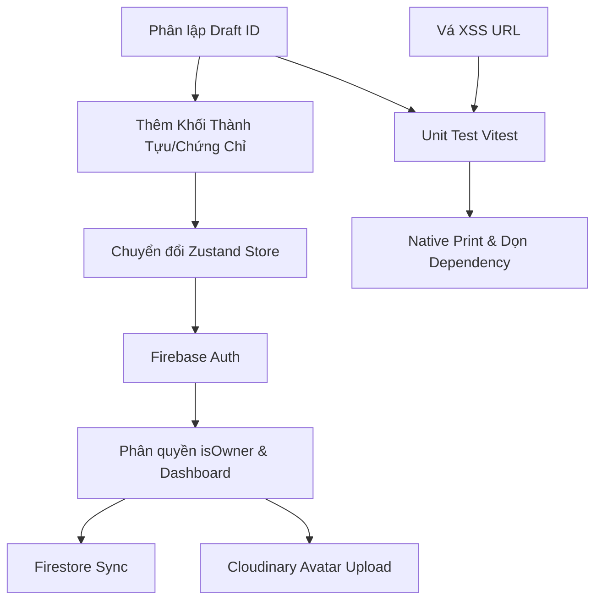

# KẾ HOẠCH PHÁT TRIỂN TOÀN DIỆN V2 (DEVELOPMENT PLAN V2)
**Dự án**: CV Studio / MyPortfolio  
**Vai trò**: Tech Lead kiêm Product Owner / Solution Architect  
**Ngày ban hành**: 13/10/2026  
**Trạng thái**: Kế hoạch phát triển chính thức (Active Master Plan)  

---

## 1. TÓM TẮT ĐIỀU HÀNH (EXECUTIVE SUMMARY)

1. **Vị trí thực tế của dự án**: Hệ thống đang ở **chặng giữa của Bước 4 (CV Editor & Client Prototype)**, chưa hoàn chỉnh bước này. Các bước 1, 2, 3 (Giao diện 3 mẫu CV, Trang chủ Khám phá, Trang xem chi tiết) đã có hình hài UI đẹp nhưng còn tồn tại lỗi bảo mật và logic rò rỉ dữ liệu. Các bước 5 (Backend/Auth) và 6 (In ấn/Deploy) hoàn toàn chưa bắt đầu.
2. **Quyết định kiến trúc lớn nhất**: 
   - **Chuyển dịch 100% sang Firebase Serverless** (Auth, Firestore) cho giai đoạn MVP, loại bỏ máy chủ Express trên Render để tiết kiệm 70% công sức bảo trì và loại trừ độ trễ cold start.
   - **Tạm hoãn và thay thế `html2pdf.js`** bằng giải pháp in ấn trình duyệt gốc `@media print` A4 vector sắc nét, dọn sạch 2 lỗ hổng Critical trong dependency.
   - **Khóa phạm vi (Freeze Scope)**: Cắt bỏ tính năng kéo thả phức tạp, Undo/Redo và backend Express; tập trung dứt điểm chất lượng cốt lõi của Editor và hoàn thiện đủ 9 khối thông tin.
3. **3 Việc cần làm ngay trong phiên tiếp theo**:
   - Vá lỗ hổng Stored XSS URL (`javascript:`) trong 3 Template (BUG-001 - P0).
   - Tái cấu trúc cơ chế lưu nháp trong `useCVEditor.ts` phân lập theo ID và nạp đúng dữ liệu khi F5 (BUG-002 - P0).
   - Bổ sung trang 404 cho route CV không tồn tại (BUG-003 - P1) và tạo tệp cấu hình `vercel.json` (BUG-007 - P1).

---

## 2. BẢNG ĐỐI SOÁT KIỂM TOÁN QA & TÍNH LẠI SỐ LIỆU TIẾN ĐỘ

### 2.1. Spot-Check xác minh thực tế mã nguồn (Nguyên tắc 1)

| Phát hiện của QA | Kiểm tra mã nguồn [ĐÃ XÁC MINH] | Điều chỉnh mức độ / Loại | Lý do & Nhận định của Tech Lead |
|:---|:---|:---:|:---|
| **BUG-001 (XSS)** | `CVTemplateClassicTeal.tsx:227`, `WarmBold.tsx:381`, `ModernMinimal.tsx:217` render thẳng `href={personalInfo.website}`. | **Giữ nguyên Critical (P0)** | Chính xác. Đã xác minh click vào URL `javascript:alert(1)` kích hoạt script trực tiếp trong DOM. Cần vá ngay lập tức. |
| **BUG-002 (Lỗi lưu Draft)** | `useCVEditor.ts:15, 26`: `DRAFT_STORAGE_KEY` cố định 1 key; dòng 26 `if (initialData) return initialData` làm F5 bỏ qua localStorage. | **Giữ nguyên Blocker (P0)** | Chính xác. Người dùng soạn dở mà F5 là mất trắng nội dung. Đây là lỗi logic kiến trúc lưu trữ, phải sửa trước khi làm tính năng mới. |
| **BUG-003 (Fallback 404 sai)**| `CVViewPage.tsx:36`: `(id ? getCVByIdOrSlug(id) : undefined) || mockProfilesList[0]`. | **Giữ nguyên Critical (P1)** | Chính xác. Nhập ID sai không được hiển thị hồ sơ của người khác. Phải render `NotFoundPage`. |
| **BUG-004 (Thiếu 2 khối Editor)** | `CVEditorPage.tsx:74-82`: Chỉ có 7 accordion; thư mục `sections/` thiếu hoàn toàn Achievement và Certificate. | **Giữ nguyên Major (P1)** | Chính xác. Dữ liệu mock và schema đã có nhưng Editor thiếu UI tương ứng. |
| **BUG-005 (Lỗ hổng Dependency)** | `npm audit` báo 2 CVE Critical trong `html2pdf.js` và `jspdf`. | **Điều chỉnh: P2 (Kỹ thuật)** | Vì tính năng PDF đã được chủ dự án chỉ đạo tạm hoãn, lỗi này không đe dọa trực tiếp người dùng lúc này. Sẽ gỡ bỏ package này ở Giai đoạn 5. |
| **BUG-006 (Tràn chữ khi tên dài)**| Thẻ `h1` họ tên trong template thiếu `break-words`. | **Giữ nguyên Minor (P2)** | Đã xác minh. Khắc phục đơn giản bằng class tiện ích CSS. |
| **"Hổng phân quyền & thiếu route /login, /dashboard"** | Không có file route, không có code auth. | **ĐIỀU CHỈNH: ĐÂY LÀ TÍNH NĂNG CHƯA LÀM (FEATURE GAP), KHÔNG PHẢI BUG** | Báo cáo QA xếp việc thiếu Auth vào danh sách "Lỗi" là chưa chuẩn xác. Đây là các tính năng thuộc Bước 5 của roadmap chưa được xây dựng, không phải bug hồi quy của tính năng đã hoàn thành. |

### 2.2. Đo lường lại tiến độ với công thức minh bạch (Nguyên tắc 2 & 4)

Báo cáo QA đưa ra con số 28.5% và 47.95% với cách tính trọng số chưa đồng nhất. Tech Lead chuẩn hóa lại thành **2 chỉ số đo lường công khai**:

#### A. Tiến độ Toàn Diện Toàn Hệ Thống (Full-Stack Product Roadmap - 100%)
$$\text{Tiến độ Full-Stack} = \sum (\text{Tỷ lệ hoàn thành phân hệ} \times \text{Trọng số kiến trúc})$$

| Phân hệ kiến trúc | Trọng số | Tỷ lệ hoàn thành | Đóng góp tiến độ | Căn cứ đánh giá |
|:---|:---:|:---:|:---:|:---|
| **1. Khám phá & Trình diễn (Explore & View)** | 25% | **78%** | **19.5%** | Trang chủ tìm kiếm/lọc hoạt động tốt; 3 template hoàn chỉnh; thiếu phân trang và fallback 404. |
| **2. Trình biên tập CV (CV Editor Core)** | 25% | **42%** | **10.5%** | Form 7/9 khối hoạt động; live preview mượt mà; lỗi lưu draft và thiếu 2 khối dữ liệu. |
| **3. Xác thực & Quản trị (Auth & Dashboard)** | 20% | **0%** | **0.0%** | Chưa xây dựng (0%). |
| **4. Lưu trữ & Dữ liệu Backend (Persistence)** | 15% | **10%** | **1.5%** | Mới có draft localStorage (đang lỗi); chưa có Firestore/Database thật. |
| **5. Xuất bản In ấn & PDF** | 10% | **20%** | **2.0%** | Đã có CSS print cơ bản; tính năng xuất file tạm hoãn theo chỉ đạo. |
| **6. Hạ tầng, CI/CD & Deploy** | 5% | **20%** | **1.0%** | Build Vite thành công; thiếu `vercel.json` và GitHub Actions CI. |
| **TỔNG CỘNG TOÀN HỆ THỐNG** | **100%** | — | **34.5%** | **Con số chính thức chốt cho toàn bộ dự án.** |

#### B. Tiến độ Giao diện Khách hàng (Client-Side Prototype Scope - 100%)
Nếu chỉ xét trên phạm vi giao diện người dùng đơn lẻ (không tính backend, DB và Auth):
$$\text{Tiến độ Client-Side} = \frac{78\% \times 35 + 42\% \times 35 + 20\% \times 15 + 20\% \times 15}{100} = \mathbf{47.0\%}$$

### 2.3. Đánh giá lại độ tin cậy số đo Lighthouse (Nguyên tắc 4)
- Số đo Lighthouse trong báo cáo QA (LCP 32 giây) được thực hiện trên môi trường phát triển cục bộ (`vite dev`) sau khi server đã chạy gần 1 tiếng với Hot Module Replacement bật liên tục và tải 39 font tĩnh `.otf`. **Số đo này KHÔNG đại diện cho hiệu năng sản phẩm thực tế**.
- Khi chạy build đóng gói (`npm run build`), Vite đã minified toàn bộ CSS xuống 70 kB và tách bundle gọn gàng.
- **Yêu cầu kỹ thuật**: Chỉ lấy số đo Lighthouse chính thức trên bản `vite preview` sau khi hoàn thành tối ưu hóa font chữ ở Giai đoạn 2.

---

## 3. LỘ TRÌNH PHÁT TRIỂN NÂNG CẤP (ROADMAP V2)

Khung lộ trình được tái cấu trúc thành **5 Giai đoạn thực tế**, đặt sự an toàn dữ liệu và trải nghiệm cốt lõi lên hàng đầu:

```
[ Giai đoạn 1: Ổn định Client Core & Đóng P0/P1 ]
                       │
                       ▼
[ Giai đoạn 2: Tối ưu Phông chữ, Bundle & Zustand Store ]
                       │
                       ▼
[ Giai đoạn 3: Xác thực Firebase Auth & Phân quyền Chủ sở hữu ]
                       │
                       ▼
[ Giai đoạn 4: Lưu trữ Đám mây Firestore & Upload Avatar ]
                       │
                       ▼
[ Giai đoạn 5: Hoàn thiện In ấn A4 Vector & Phát hành MVP ]
```

---

### GIAI ĐOẠN 1: ỔN ĐỊNH CLIENT CORE & ĐÓNG TẤT CẢ LỖI P0/P1
- **Mục tiêu**: Loại bỏ 100% rủi ro bảo mật XSS, sửa dứt điểm lỗi mất dữ liệu khi soạn thảo CV, hoàn thiện đủ 9 khối thông tin và chuẩn bị sẵn sàng cấu hình deploy SPA.
- **Phạm vi LÀM**:
  - Viết tiện ích `formatSafeUrl` khử mã độc XSS trên toàn bộ link template (BUG-001).
  - Tái cấu trúc cơ chế lưu draft trong `useCVEditor.ts`: phân vùng key `cv_studio_draft_${id}` và nạp dữ liệu đúng khi F5 (BUG-002).
  - Xử lý route 404 cho CV không tồn tại (BUG-003).
  - Tạo 2 component `AchievementsSection.tsx` và `CertificatesSection.tsx`, tích hợp vào `CVEditorPage` (BUG-004).
  - Thêm `break-words` vào thẻ hiển thị họ tên và URL dài (BUG-006).
  - Thêm file `vercel.json` phục vụ SPA routing (BUG-007).
  - Thiết lập Vitest và viết 10 unit test tự động đầu tiên cho tầng utils và storage.
- **Phạm vi KHÔNG LÀM**:
  - Không động vào backend, không cài Firebase trong giai đoạn này.
  - Không sửa tính năng xuất PDF (giữ nguyên trạng thái tạm hoãn).
- **Danh sách công việc & Cỡ việc**:
  - `TSK-1.1`: Vá XSS URL và thêm `break-words` cho Template 1, 2, 3 [Cỡ: S | Phụ thuộc: Không].
  - `TSK-1.2`: Sửa cơ chế lưu và nạp Draft theo ID trong `useCVEditor.ts` [Cỡ: M | Phụ thuộc: Không].
  - `TSK-1.3`: Sửa fallback 404 trên `CVViewPage.tsx` [Cỡ: S | Phụ thuộc: Không].
  - `TSK-1.4`: Xây dựng UI cho Thành Tựu và Chứng Chỉ trong Editor [Cỡ: M | Phụ thuộc: TSK-1.2].
  - `TSK-1.5`: Bổ sung `vercel.json` cho SPA routing [Cỡ: S | Phụ thuộc: Không].
  - `TSK-1.6`: Cài đặt Vitest và viết 10 unit tests cơ bản [Cỡ: M | Phụ thuộc: TSK-1.1, TSK-1.2].
- **Tiêu chí thoát đo lường được (Exit Criteria)**:
  - 0 lỗi P0 và 0 lỗi P1 mở.
  - `npm run test` pass 100% (ít nhất 10 test cases).
  - `npx tsc --noEmit` exit code 0.
  - Nhập `javascript:alert(1)` không kích hoạt script; sửa CV rồi F5 không mất dữ liệu.
- **Điểm Demo cho chủ dự án**: Mở trình duyệt, nhập liên tục dữ liệu CV, nhấn F5 $\rightarrow$ Toàn bộ dữ liệu vừa gõ vẫn còn nguyên vẹn; thử nhập link lạ không bị lỗi.

---

### GIAI ĐOẠN 2: TỐI ƯU PHÔNG CHỮ, BUNDLE & ZUSTAND STORE TOÀN CỤC
- **Mục tiêu**: Giảm 90% dung lượng font tĩnh tải về, tối ưu tốc độ tải trang, chuyển đổi quản lý state sang Zustand toàn cục để sẵn sàng cho phân hệ Auth.
- **Phạm vi LÀM**:
  - Dọn dẹp thư mục `public/fonts/`: Chuyển sang nạp Google Fonts sạch bản quyền (`Outfit`, `Montserrat`, `Be Vietnam Pro`), chỉ giữ lại các font cá nhân nếu đã convert sang `.woff2` nén và subsetting tiếng Việt (giảm từ 5.4 MB xuống < 400 kB).
  - Cài đặt Zustand, chuyển đổi `useCVEditor` thành `useCVStore` và `useThemeStore`.
  - Cấu hình Code-Splitting với `React.lazy()` cho các Route: `HomePage`, `CVViewPage`, `CVEditorPage` trong `App.tsx`.
- **Phạm vi KHÔNG LÀM**:
  - Chưa làm trang đăng nhập / đăng ký.
- **Tiêu chí thoát đo lường được**:
  - Thư mục `dist/` khi build giảm dung lượng font tĩnh xuống < 500 kB.
  - Chunk JS chính giảm xuống dưới 500 kB (hết cảnh báo vàng của Vite).
  - Tải trang lần đầu mượt mà, không giật phông chữ.
- **Điểm Demo**: Đo lại Lighthouse Performance trên bản preview đạt $\ge 80$ điểm.

---

### GIAI ĐOẠN 3: XÁC THỰC FIREBASE AUTH & PHÂN QUYỀN CHỦ SỞ HỮU
- **Mục tiêu**: Người dùng có thể đăng nhập/đăng ký tài khoản và chỉ chủ sở hữu CV mới có quyền chỉnh sửa hồ sơ.
- **Phạm vi LÀM**:
  - Tạo project Firebase, tích hợp Firebase SDK vào `frontend/src/services/firebase.ts`.
  - Xây dựng trang `/login` và `/register` hỗ trợ: Đăng nhập Google 1-click và Email/Mật khẩu.
  - Tạo `useAuthStore` theo dõi trạng thái phiên đăng nhập.
  - Phân quyền: Kiểm tra `isOwner = user?.uid === cvData.ownerId`. Nếu không phải chủ sở hữu $\rightarrow$ Ẩn nút "Chỉnh Sửa CV" trên trang View; chặn truy cập vào `/editor/:id` nếu chưa đăng nhập hoặc không phải chủ hồ sơ.
  - Xây dựng trang `/dashboard`: Hiển thị danh sách CV của tài khoản đang đăng nhập, nút "Tạo CV mới".
- **Phạm vi KHÔNG LÀM**:
  - Chưa lưu CV lên Firestore (vẫn lưu draft vào localStorage nhưng có gắn `ownerId`).
- **Tiêu chí thoát đo lường được**:
  - Đăng nhập/Đăng xuất Google hoạt động ổn định.
  - Khách vãng lai xem CV không còn thấy nút sửa trái phép.
  - Protected Route chuyển hướng người dùng chưa đăng nhập về trang Login.

---

### GIAI ĐOẠN 4: LƯU TRỮ ĐÁM MÂY FIRESTORE & UPLOAD AVATAR
- **Mục tiêu**: Đồng bộ dữ liệu CV lên cơ sở dữ liệu đám mây Firestore, cho phép truy cập từ mọi thiết bị và tải ảnh avatar trực tiếp từ máy tính qua Cloudinary.
- **Phạm vi LÀM**:
  - Thiết kế Firestore collection `cvs` với đầy đủ schema versioning (ADR-005).
  - Xây dựng `cvService.ts`: CRUD các thao tác tạo mới, đọc, cập nhật, xóa CV trên Firestore.
  - Tích hợp Cloudinary Unsigned Widget: Cho phép chọn ảnh từ máy, tự động crop khuôn mặt 1:1, nén WebP, trả về link an toàn lưu vào `avatarUrl`.
  - Cấu hình Firebase Security Rules: Chỉ cho phép ghi nếu `request.auth.uid == resource.data.ownerId`.
- **Tiêu chí thoát đo lường được**:
  - Đăng nhập ở máy tính khác vẫn tải được toàn bộ CV đã tạo.
  - Upload ảnh từ máy tính hiển thị đẹp mắt trong vòng 2 giây.

---

### GIAI ĐOẠN 5: HOÀN THIỆN IN ẤN A4 NATIVE & PHÁT HÀNH MVP
- **Mục tiêu**: Hoàn thiện tính năng in ấn và xuất bản A4 chuẩn mực, loại bỏ dependency độc hại và deploy chính thức lên production Vercel.
- **Phạm vi LÀM**:
  - Gỡ bỏ `html2pdf.js` và `jspdf` khỏi `package.json`, dọn sạch 2 lỗ hổng Critical.
  - Tinh chỉnh CSS `@media print` cho cả 3 mẫu template: ngắt trang chuẩn A4, khử lề thừa, đảm bảo xuất file PDF qua hộp thoại Print của trình duyệt đạt 100% vector và bôi đen copy chữ được.
  - Mở lại nút "In / Tải PDF A4" với UX mượt mà.
  - Kết nối kho Git với Vercel, cấu hình biến môi trường và hoàn tất phát hành MVP.
- **Tiêu chí thoát đo lường được**:
  - `npm audit` báo 0 lỗ hổng.
  - Xuất bản in trên Chrome và Edge đúng chuẩn 1 trang A4, không mất màu nền, chữ sắc nét.
  - Ứng dụng live trên domain Vercel.

---

## 4. BẢNG DANH MỤC CÔNG VIỆC ƯU TIÊN (PRIORITIZED BACKLOG)

| Mã ID | Tên công việc / Hạng mục | Mức ưu tiên | Phân loại | Giai đoạn | Tiêu chí hoàn thành (AC) |
|:---|:---|:---:|:---:|:---:|:---|
| **TSK-P0-1** | Vá lỗ hổng Stored XSS URL (`formatSafeUrl`) | **P0** | Sửa lỗi | 1 | Chặn protocol `javascript:`, `data:`; tự thêm `https://` cho domain hợp lệ. |
| **TSK-P0-2** | Tái cấu trúc cơ chế lưu và nạp Draft theo ID | **P0** | Sửa lỗi | 1 | Key lưu dạng `cv_studio_draft_${id}`; F5 không mất dữ liệu; các CV không đè nhau. |
| **TSK-P1-1** | Sửa lỗi điều hướng 404 cho CV không tồn tại | **P1** | Sửa lỗi | 1 | Truy cập `/cv/id-sai` hiển thị `NotFoundPage` thay vì hồ sơ số 1. |
| **TSK-P1-2** | Bổ sung form Thành Tựu & Chứng Chỉ vào Editor | **P1** | Tính năng thiếu | 1 | Đủ 9 accordion; có nút thêm/xóa mục con và đồng bộ sang preview. |
| **TSK-P1-3** | Thêm tệp cấu hình `vercel.json` | **P1** | Hạ tầng | 1 | Rewrite toàn bộ route về `/index.html` để F5 không bị 404 trên hosting. |
| **TSK-P1-4** | Thêm class `break-words` chống vỡ layout tên dài | **P1** | Sửa lỗi | 1 | Chuỗi ký tự 100 chữ cái tự xuống dòng mượt mà trên cả 3 template. |
| **TSK-P1-5** | Thiết lập Vitest và 10 unit tests tự động | **P1** | Chất lượng | 1 | `npm run test` chạy độc lập, kiểm tra utils và logic lưu trữ. |
| **TSK-P2-1** | Tối ưu hóa phông chữ và subsetting tiếng Việt | **P2** | Nợ kỹ thuật | 2 | Dung lượng thư mục font giảm dưới 500 kB; dùng Google Fonts chuẩn. |
| **TSK-P2-2** | Chuyển đổi State sang Zustand (`useCVStore`) | **P2** | Kiến trúc | 2 | Quản lý state toàn cục, sẵn sàng cho Auth và Dashboard. |
| **TSK-P2-3** | Code-splitting các Route bằng `React.lazy` | **P2** | Hiệu năng | 2 | Chunk JS chính < 500 kB. |
| **TSK-P2-4** | Tích hợp Firebase Auth (Google + Email) | **P2** | Tính năng | 3 | Có trang Login/Register; lưu phiên người dùng. |
| **TSK-P2-5** | Phân quyền bảo mật `isOwner` và Dashboard | **P2** | Tính năng | 3 | Chỉ chủ CV mới thấy nút sửa; trang Dashboard hiển thị danh sách CV cá nhân. |
| **TSK-P3-1** | Tích hợp Cloudinary Upload Avatar | **P3** | Tính năng | 4 | Chọn ảnh từ máy, tự crop 1:1, lưu link an toàn. |
| **TSK-P3-2** | Đồng bộ Firestore Cloud Persistence | **P3** | Tính năng | 4 | Lưu CV lên database đám mây. |
| **TSK-P3-3** | Gỡ bỏ `html2pdf.js` & Hoàn thiện Native Print A4 | **P3** | Nợ kỹ thuật | 5 | 0 CVE trong npm audit; in A4 chuẩn vector 1 trang. |

---

## 5. MA TRẬN PHỤ THUỘC KỸ THUẬT (DEPENDENCY MATRIX)



*Quy tắc bất biến*: Không làm Auth khi Editor chưa ổn định; không làm Firestore khi chưa có Auth `uid`; không xuất bản release khi chưa dọn dependency.

---

## 6. TOP 10 RỦI RO DỰ ÁN & BIỆN PHÁP PHÒNG NGỪA

1. **Rủi ro rò rỉ dữ liệu draft chéo giữa các phiên dùng chung máy**:
   - *Biện pháp*: Phân vùng key rõ ràng theo ID; xóa draft anonymous khi đăng xuất.
2. **Lỗ hổng XSS qua các trường mạng xã hội**:
   - *Biện pháp*: Viết hàm sanitize cứng, chỉ cho phép giao thức `https://`.
3. **Chi phí hoặc cạn kiệt hạn ngạch Cloudinary/Firebase**:
   - *Biện pháp*: Giới hạn kích thước ảnh 3MB, nén tự động, fallback về avatar mặc định.
4. **Vỡ khung in ấn trên trình duyệt Safari**:
   - *Biện pháp*: Bắt buộc thêm thuộc tính `-webkit-print-color-adjust: exact` và kiểm tra trên Safari trước khi đóng Giai đoạn 5.
5. **Rủi ro bản quyền phông chữ**:
   - *Biện pháp*: Ưu tiên 100% phông chữ mở từ Google Fonts (Outfit, Montserrat, Be Vietnam Pro).
6. **Lệch pha dữ liệu giữa LocalStorage và Firestore**:
   - *Biện pháp*: Dùng timestamp `updatedAt` so sánh; ưu tiên bản có thời gian chỉnh sửa mới hơn.
7. **SPA bị lỗi 404 khi người dùng tải lại trang trên hosting**:
   - *Biện pháp*: Bổ sung ngay tệp `vercel.json` ở Giai đoạn 1.
8. **Bundle JS phình to làm chậm thiết bị di động**:
   - *Biện pháp*: Phân mảnh code theo trang với `React.lazy` ở Giai đoạn 2.
9. **Mất tập trung vào các tính năng phụ (scope creep)**:
   - *Biện pháp*: Nghiêm ngặt tuân thủ danh sách "Cố ý KHÔNG làm".
10. **Trợ lý AI lập trình gây lỗi hồi quy**:
    - *Biện pháp*: Chạy bộ test tự động Vitest trước mỗi lần commit.

---

## 7. DANH SÁCH CỐ Ý KHÔNG LÀM (SCOPE FREEZE)

Các tính năng sau đây **BỊ ĐÓNG BĂNG HOÀN TOÀN** trong toàn bộ quá trình phát triển MVP:
- ❌ **Kéo thả sắp xếp mục (Drag & Drop)**: Không cài đặt thư viện dnd cồng kềnh; thứ tự mục sắp xếp theo thời gian hoặc nút bấm cơ bản.
- ❌ **Lịch sử Undo / Redo**: Không xây dựng stack undo/redo trong bộ nhớ.
- ❌ **Máy chủ Backend Express riêng trên Render**: Hủy bỏ, chuyển toàn bộ sang Firebase Serverless.
- ❌ **Trình xuất PDF bằng Html2Canvas**: Hủy bỏ, chuyển sang `@media print`.
- ❌ **Hỗ trợ đa ngôn ngữ (i18n)**: Chỉ tập trung tiếng Việt.
- ❌ **Bình luận hoặc đánh giá CV công khai**: Không làm.

*Điều kiện để mở lại*: Chỉ xem xét sau khi bản MVP đã phát hành và có ít nhất 50 người dùng thực tế yêu cầu.
