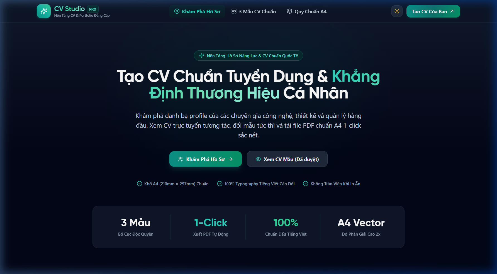
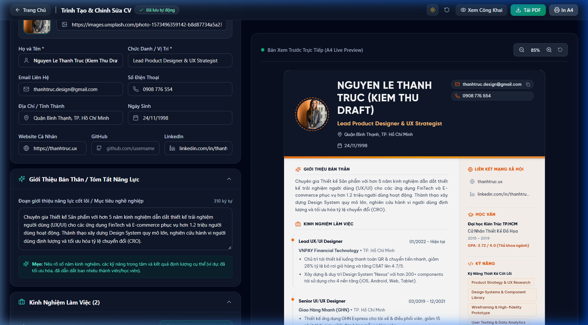
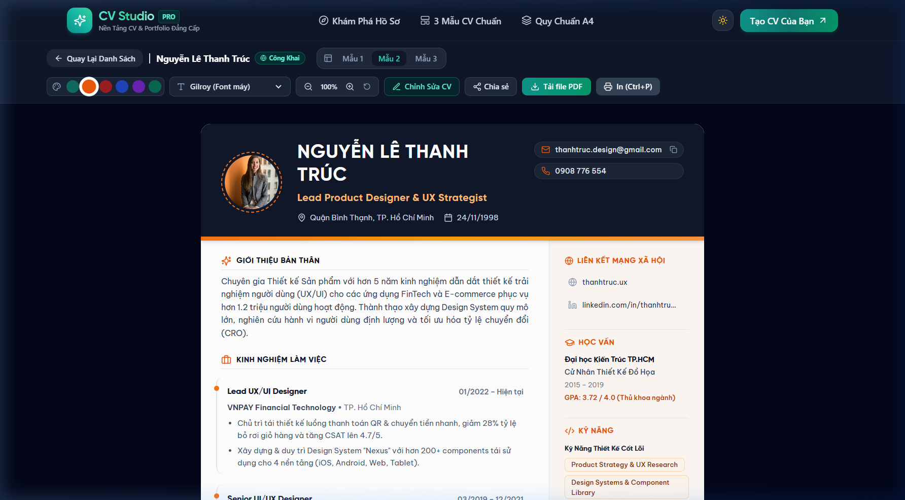

# CV Studio — Nền Tảng Tạo & Quản Lý CV Cá Nhân Trực Tuyến

<p align="center">
  <strong>Tạo hồ sơ năng lực (CV/Portfolio) trực tuyến, tùy biến đa phong cách, tối ưu tiếng Việt và kiểm soát bố cục A4 chuẩn mực.</strong>
</p>

<p align="center">
  <a href="#trạng-thái-dự-án"></a>
  <a href="#kiểm-thử-tự-động"></a>
  <a href="LICENSE"></a>
  <a href="https://react.dev/"></a>
  <a href="https://www.typescriptlang.org/"></a>
  <a href="https://tailwindcss.com/"></a>
</p>

<p align="center">
  <a href="README.en.md"><strong>English Version (README.en.md)</strong></a> | <a href="#bắt-đầu-nhanh-trong-5-phút"><strong>Cài Đặt Nhanh</strong></a> | <a href="docs/ARCHITECTURE.md"><strong>Kiến Trúc</strong></a> | <a href="CHANGELOG.md"><strong>Nhật Ký Thay Đổi</strong></a>
</p>

---

## 1. Tổng Quan Sản Phẩm

**CV Studio** là một nền tảng mã nguồn mở hỗ trợ ứng viên, chuyên viên công nghệ và nhà thiết kế kiến tạo bản CV/Portfolio cá nhân trực quan, sắc nét và chuyên nghiệp.

- **Vấn đề giải quyết**: Đa số công cụ tạo CV trực tuyến hiện nay thường gò bó trong định dạng cứng nhắc, font chữ lỗi dấu tiếng Việt, xuất file vỡ khung hình, hoặc yêu cầu trả phí để lưu trữ bản nháp.
- **Giải pháp**: Xây dựng một ứng dụng web dạng Client-Side Single Page Application (SPA) với kiến trúc linh hoạt:
  - Xem trước thời gian thực (Live Preview) theo từng phím gõ.
  - Tách biệt nội dung dữ liệu (`CVData`) khỏi lớp hiển thị thông qua **Template Registry**.
  - Tự động lưu trữ cục bộ an toàn, không phụ thuộc máy chủ ở giai đoạn đầu.
- **Đối tượng sử dụng**: Lập trình viên, Nhà thiết kế, Chuyên viên dữ liệu, Marketer và Nhân sự muốn sở hữu một trang CV cá nhân trực tuyến chỉn chu.

---

## 2. Trạng Thái Dự Án (Project Status)

> [!NOTE]
> **Dự án hiện đang ở giai đoạn Client-Side Prototype (v0.1.0).**  
> Dữ liệu hồ sơ và các chỉnh sửa hiện được lưu trữ an toàn trong bộ nhớ trình duyệt (`localStorage`) của người dùng. Hệ thống **chưa tích hợp Backend database và Authentication**. Lộ trình tích hợp Firebase Auth và Cloud Firestore sẽ được triển khai ở Giai đoạn 3 & 4.

### Ma trận tính năng thực tế

| Phân hệ / Tính năng | Trạng thái | Chi tiết kỹ thuật |
|:---|:---:|:---|
| **Trang Khám Phá Hồ Sơ (`/`)** | ✅ Hoàn thành | Tìm kiếm theo từ khóa họ tên/kỹ năng, lọc danh mục (Tech, Design, Data & AI, Marketing, HR). |
| **Trang Xem CV Chi Tiết (`/cv/:id`)** | ✅ Hoàn thành | Khổ A4 chuẩn mực, thanh công cụ sao chép link, in ấn và điều hướng chỉnh sửa. |
| **Mẫu CV 1: Classic Teal** | ✅ Hoàn thành | Bố cục 2 cột sidebar xanh biển thanh lịch, tối ưu không gian hiển thị. |
| **Mẫu CV 2: Warm Bold** | ✅ Hoàn thành | Tone màu cam Tangerine ấm áp, khối nổi bật cho Senior & Lead. |
| **Mẫu CV 3: Modern Minimal** | ✅ Hoàn thành | Phong cách tối giản quốc tế, thanh mảnh và hiện đại. |
| **Trình Biên Tập Trực Quan (`/editor/:id`)** | ✅ Hoàn thành | Chia 2 cột: 9 nhóm form Accordion bên trái, bản xem trước A4 thu phóng trực tiếp bên phải. |
| **Lưu Bản Nháp Cục Bộ (Draft Storage)** | ✅ Hoàn thành | Tự động lưu sau 600ms debounce, phân lập theo ID (`cv_studio_draft_${id}`), F5 giữ nguyên 100% dữ liệu. |
| **Tùy Biến Giao Diện Động** | ✅ Hoàn thành | Đổi tức thì 6 bộ màu accent, 5 bộ font chữ Việt hóa, và chế độ nền giấy Sáng/Tối. |
| **Dark Mode Toàn Diện (Zero-FOUC)** | ✅ Hoàn thành | Loại bỏ triệt để hiện tượng nháy trắng khi reload trang bằng blocking script đồng bộ tại `<head>`. |
| **Phòng Chống Lỗ Hổng XSS** | ✅ Hoàn thành | Hàm `formatSafeUrl()` lọc sạch scheme nguy hiểm (`javascript:`, `data:`). |
| **Điều Hướng Trang 404** | ✅ Hoàn thành | Tự động render trang `NotFoundPage` chuẩn khi nhập ID không tồn tại trên hệ thống. |
| **Tối Ưu Bundle & Phông Chữ WOFF2** | 🚧 Đang làm dở | Kế hoạch Giai đoạn 2: Subsetting font từ 5.4 MB xuống dưới 400 kB và `React.lazy()` routes. |
| **Chuyển Đổi Quản Lý State (Zustand)** | 🚧 Đang làm dở | Kế hoạch Giai đoạn 2: Thay thế `useState` trong `useCVEditor` bằng Zustand Store toàn cục. |
| **Xác Thực Tài Khoản (Firebase Auth)** | ⏳ Chưa làm | Kế hoạch Giai đoạn 3: Đăng nhập Google 1-click & Email/Password, phân quyền `isOwner`. |
| **Lưu Trữ Đám Mây (Cloud Firestore)** | ⏳ Chưa làm | Kế hoạch Giai đoạn 4: Đồng bộ đa thiết bị và chia sẻ liên kết cá nhân thực thụ. |
| **Tải Lên Ảnh Đại Diện (Cloudinary)** | ⏳ Chưa làm | Kế hoạch Giai đoạn 4: Upload từ máy tính, tự động crop tỉ lệ 1:1 và nén WebP. |
| **Xuất File PDF In Ấn (Native Print)** | ⏳ Chưa làm | Kế hoạch Giai đoạn 5: Chuẩn hóa CSS `@media print` A4 native, gỡ bỏ thư viện `html2pdf.js`. |

---

## 3. Giao Diện Sản Phẩm (Screenshots)

### 3.1. Trang Chủ Khám Phá Hồ Sơ
<p align="center">
  
  <br />
  <em>Giao diện khám phá hồ sơ ứng viên tiêu biểu kèm bộ lọc ngành nghề trực quan</em>
</p>

### 3.2. Trình Biên Tập CV Trực Quan (Split-Screen Editor)
<p align="center">
  
  <br />
  <em>Trình biên tập 2 cột: Khối form 9 mục bên trái và Bản xem trước A4 Live Preview bên phải</em>
</p>

### 3.3. Trang Xem Chi Tiết Hồ Sơ CV
<p align="center">
  
  <br />
  <em>Bản CV toàn màn hình sắc nét, hỗ trợ thanh công cụ chia sẻ và chuyển đổi nhanh</em>
</p>

---

## 4. Công Nghệ Sử Dụng (Tech Stack)

### Đang vận hành trong mã nguồn (Current Prototype)
- **Cốt lõi**: React 18, TypeScript 5.6, Vite 5.4.
- **Tạo kiểu (Styling)**: Tailwind CSS 3.4, PostCSS, Autoprefixer.
- **Điều hướng (Routing)**: React Router DOM v7 (Client-side routing).
- **Biểu tượng (Icons)**: Lucide React (hơn 40 icons đồng bộ).
- **Kiểm thử (Testing)**: Vitest 2.1, @testing-library/react, @testing-library/dom, JSDOM.
- **Typography**: Google Fonts (`Outfit`, `Be Vietnam Pro`) kết hợp bộ font tự lưu trữ (`iCiel Cubano`, `SVN-Optima`, `Gilroy`, `Montserrat`).

### Lộ trình tích hợp tiếp theo (Target Architecture)
- **State Management**: Zustand v5.
- **Backend as a Service (BaaS)**: Firebase Authentication & Cloud Firestore (Serverless).
- **Media CDN**: Cloudinary Unsigned Upload Widget.
- **Hosting & CI/CD**: Vercel (Frontend SPA) + GitHub Actions.

---

## 5. Bắt Đầu Nhanh Trong 5 Phút (Quick Start)

### Yêu cầu tiên quyết
- **Node.js**: Phiên bản `18.x` hoặc `20.x` trở lên (Khuyến nghị: Node 20 LTS).
- **Trình quản lý gói**: `npm` phiên bản `9.x` hoặc `10.x`.

### 1. Clone repository
```bash
git clone https://github.com/username/cv-studio.git
cd cv-studio
```

### 2. Cài đặt dependencies
Dự án được cấu hình dạng monorepo với frontend nằm trong thư mục `frontend/`:
```bash
# Cài đặt toàn bộ dependencies cho frontend
cd frontend
npm install
```

### 3. Khởi chạy máy chủ phát triển
```bash
npm run dev
```
Truy cập trình duyệt tại địa chỉ: `http://localhost:3000/`.

### 4. Build bản đóng gói production
```bash
npm run build
```
Bản build tĩnh tối ưu hóa sẽ được xuất ra tại thư mục `frontend/dist/`.

---

## 6. Kiểm Thử Tự Động (Testing)

Dự án tích hợp bộ kiểm thử đơn vị tự động với Vitest để bảo vệ tính toàn vẹn của mã nguồn:

```bash
cd frontend
npm run test
```

### Kết quả kiểm thử hiện tại
```text
 ✓ src/utils/__tests__/url.test.ts (6 tests)
 ✓ src/data/__tests__/mockProfiles.test.ts (4 tests)
 ✓ src/features/cv-editor/hooks/__tests__/useCVEditor.test.ts (5 tests)

 Test Files  3 passed (3)
      Tests  15 passed (15)
   Duration  2.38s
```
- **Kiểm tra an toàn URL**: 100% các chuỗi `javascript:alert(1)`, `data:text/html` đều bị lọc và vô hiệu hóa thành `#`.
- **Kiểm tra lưu nháp**: Xác minh cơ chế cô lập draft theo `id` và khôi phục toàn vẹn dữ liệu khi tải lại trang (F5).
- **Kiểm tra thao tác dữ liệu**: Xác minh logic thêm/xóa kinh nghiệm, kỹ năng, thành tựu và chứng chỉ trong hook.

---

## 7. Cấu Trúc Thư Mục (Folder Structure)

```text
cv-studio/
├── docs/                        # Tài liệu kiến trúc, ảnh chụp và release notes
│   ├── ARCHITECTURE.md          # Đặc tả kiến trúc chi tiết và sơ đồ Mermaid
│   ├── images/                  # Thư viện ảnh chụp sản phẩm thực tế
│   └── releases/                # Ghi chú phát hành cho từng phiên bản
│
├── frontend/                    # Ứng dụng chính (Vite + React + TypeScript)
│   ├── public/fonts/            # Bộ font chữ Việt hóa tự lưu trữ
│   ├── src/
│   │   ├── components/          # Layout (Navbar, Footer) & UI components
│   │   ├── features/
│   │   │   ├── cv-editor/       # Trình biên tập 9 khối form & useCVEditor hook
│   │   │   ├── cv-templates/    # Registry & 3 mẫu thiết kế CV
│   │   │   └── explore/         # Danh mục khám phá & thanh lọc hồ sơ
│   │   ├── data/                # Mock profiles & mock CV data
│   │   ├── pages/               # HomePage, CVViewPage, CVEditorPage, NotFoundPage
│   │   ├── styles/              # CSS tokens, Tailwind base, Print styling
│   │   ├── types/               # TypeScript interfaces (CVData, ThemeConfig)
│   │   └── utils/               # Tiện ích sanitize URL, date formatting
│   ├── index.html               # Entry HTML với blocking script khử FOUC
│   ├── package.json             # Cấu hình scripts & dependencies
│   └── vite.config.ts           # Cấu hình Vite & Vitest environment
│
├── backend/                     # Khung stub backend cũ (sẽ thay thế bằng Firebase)
├── vercel.json                  # Cấu hình rewrite định tuyến SPA cho Vercel
├── LICENSE                      # Giấy phép MIT kèm lưu ý bản quyền font
├── SECURITY.md                  # Chính sách bảo mật & báo cáo lỗ hổng
├── CONTRIBUTING.md              # Quy chuẩn đóng góp mã nguồn
└── CHANGELOG.md                 # Nhật ký phiên bản chuẩn Keep a Changelog
```

---

## 8. Hướng Dẫn Thêm Mẫu CV Mới (Dành Cho Nhà Phát Triển)

Hệ thống sử dụng **Template Registry Pattern** giúp việc thêm mẫu CV mới cực kỳ đơn giản:

1. Tạo thư mục mới tại `frontend/src/features/cv-templates/template-x/`.
2. Tạo component mẫu kế thừa kiểu `TemplateProps`:
   ```typescript
   import { CVData, ThemeConfig } from '../../../types/cv';

   interface TemplateProps {
     data: CVData;
     theme: ThemeConfig;
   }

   export const CVTemplateCreative: React.FC<TemplateProps> = ({ data, theme }) => {
     return <div className="page-a4">...</div>;
   };
   ```
3. Đăng ký mẫu mới vào [`TemplateRegistry.ts`](frontend/src/features/cv-templates/TemplateRegistry.ts):
   ```typescript
   export const TEMPLATES_REGISTRY: Record<string, TemplateRegistration> = {
     // ... các mẫu hiện tại
     'template-creative': {
       id: 'template-creative',
       name: 'Creative Canvas',
       description: 'Mẫu thiết kế phá cách cho Designer & Creator',
       component: CVTemplateCreative,
     },
   };
   ```
Mẫu mới sẽ tự động xuất hiện trong menu lựa chọn của cả Trình biên tập lẫn Trang xem chi tiết!

---

## 9. Vấn Đề Đã Biết & Lưu Ý Bảo Mật (Known Issues)

1. **Thư viện PDF cũ (`html2pdf.js`)**: Bản build hiện tại ghi nhận cảnh báo lỗ hổng bảo mật trong `html2pdf.js@0.10.2` và `jspdf@2.5.1`. Tính năng xuất PDF tạm thời bị ẩn trên giao diện; toàn bộ in ấn khuyến nghị sử dụng chức năng in chuẩn trình duyệt (Ctrl + P / In A4).
2. **Font chữ cá nhân hóa**: Một số font chữ được cung cấp sẵn nhằm mục đích trình diễn học tập. Nếu đưa vào ứng dụng thương mại, vui lòng mua bản quyền từ tác giả hoặc sử dụng các phông chữ mở từ Google Fonts.
3. Để báo cáo lỗi bảo mật, vui lòng đọc [SECURITY.md](SECURITY.md).

---

## 10. Giấy Phép & Tác Quyền (License)

Dự án được phân phối dưới giấy phép [MIT License](LICENSE).  
Bản quyền © 2026 **Trần Anh Khôi** và các Cộng tác viên.
