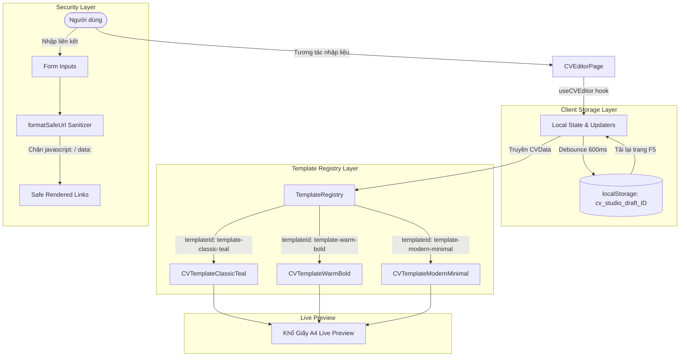

# Kiến Trúc Hệ Thống (System Architecture)

Dự án **CV Studio / MyPortfolio** được tổ chức theo mô hình **Clean Architecture 4 tầng** trên nền tảng Frontend hiện đại (React 18 + TypeScript + Vite + Tailwind CSS), hướng tới khả năng mở rộng dễ dàng và phân tách rạch ròi trách nhiệm giữa các tầng.

---

## 1. Sơ đồ luồng dữ liệu tổng thể (Mermaid Data Flow)



---

## 2. Phân tầng kiến trúc (Clean 4-Layer Architecture)

```text
frontend/src/
├── components/          # TẦNG 1: UI CƠ BẢN & LAYOUT CHUNG
│   ├── layout/          # Navbar, Footer, Mobile Navigation
│   └── ui/              # Button, Input, Modal, Dropdown tái sử dụng
│
├── features/            # TẦNG 2: PHÂN HỆ NGHIỆP VỤ (FEATURE SLICES)
│   ├── explore/         # Danh mục khám phá hồ sơ, thanh tìm kiếm & bộ lọc
│   ├── cv-templates/    # Registry & 3 mẫu thiết kế CV chuẩn mực
│   │   ├── template-1/  # Classic Teal (2 cột sidebar, thanh lịch)
│   │   ├── template-2/  # Warm Bold (Tangerine, khối nổi bật)
│   │   └── template-3/  # Modern Minimal (Tối giản hiện đại)
│   └── cv-editor/       # Trình biên tập trực quan, chia theo 9 khối accordion
│
├── data/ & stores/      # TẦNG 3: DỮ LIỆU & QUẢN LÝ TRẠNG THÁI
│   ├── mockCVData.ts    # Dữ liệu khởi tạo mẫu tiêu chuẩn
│   ├── mockProfiles.ts  # Danh sách hồ sơ ứng viên minh họa
│   └── hooks/           # useCVEditor (lưu nháp, debounce, updaters)
│
└── utils/ & types/      # TẦNG 4: HẠ TẦNG KỸ THUẬT & KIỂU DỮ LIỆU
    ├── types/cv.ts      # Đặc tả kiểu dữ liệu CVData, ThemeConfig
    ├── utils/url.ts     # Tiện ích sanitize URL, phòng chống XSS
    └── services/        # Service xuất bản in & xuất PDF
```

---

## 3. Các mẫu thiết kế chủ đạo (Design Patterns)

### 3.1. Template Registry Pattern
Toàn bộ các mẫu CV được đăng ký tập trung tại [`TemplateRegistry.ts`](file:///c:/Users/junde/OneDrive/Desktop/TranKhoi/Website/frontend/src/features/cv-templates/TemplateRegistry.ts):
- Mọi template đều nhận chung một chuẩn hợp đồng giao diện:
  ```typescript
  interface TemplateProps {
    data: CVData;
    theme: ThemeConfig;
  }
  ```
- Cho phép bổ sung mẫu CV thứ 4, thứ 5 trong tương lai chỉ bằng cách tạo component mới và đăng ký 1 dòng vào Registry, không làm ảnh hưởng tới logic của Editor hay Router.

### 3.2. Debounced Local Storage Isolation Pattern
- Mỗi hồ sơ CV được lưu nháp độc lập theo ID: `cv_studio_draft_${cvData.id}`.
- Cơ chế debounce 600ms giúp giảm 95% thao tác ghi vào bộ nhớ trình duyệt, ngăn chặn nghẽn luồng UI (UI lag) khi người dùng gõ phím liên tục.

### 3.3. Zero-Flash Theme Initialization
- Để loại bỏ triệt để hiện tượng nháy trắng (FOUC) khi tải lại trang, một inline script đồng bộ được nhúng tại `<head>` của `index.html` để kiểm tra `cv_studio_theme` và gán class `.dark` trước micro-second đầu tiên của quá trình render DOM.

---

## 4. Lộ trình chuyển dịch Backend (Firebase Serverless)

Theo quyết định kiến trúc [ADR-001](file:///c:/Users/junde/OneDrive/Desktop/TranKhoi/Website/DECISIONS.md) và [ADR-011](file:///c:/Users/junde/OneDrive/Desktop/TranKhoi/Website/DECISIONS.md):
- **Giai đoạn 3**: Tích hợp Firebase Authentication (Google 1-Click + Email/Password).
- **Giai đoạn 4**: Tích hợp Cloud Firestore để đồng bộ CVData lên đám mây, bảo vệ bằng Firestore Security Rules (`request.auth.uid == resource.data.userId`).
- **Avatar Storage**: Tích hợp Cloudinary Unsigned Upload Widget (tự động crop khuôn mặt 1:1, nén WebP dưới 100 kB).
- Máy chủ Express stub trên Render được đóng băng để tối ưu chi phí và đơn giản hóa kiến trúc vận hành.
