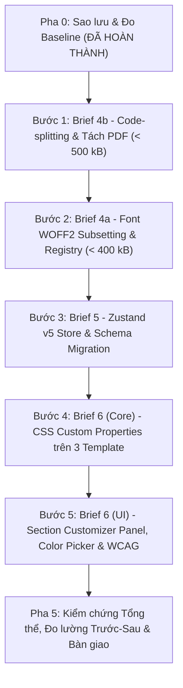

# KẾ HOẠCH TRIỂN KHAI CHI TIẾT GIAI ĐOẠN 2 (IMPLEMENTATION PLAN)
**Đề án:** Tối ưu Hiệu năng (Bundle / Font), Di chuyển Zustand Store và Tính năng Tùy biến Chi tiết theo Phần (Briefs 4a, 4b, 5, 6)

- **Kiến trúc sư phụ trách:** Senior Frontend Architect kiêm Engineer
- **Ngày ban hành:** 13/10/2026
- **Trạng thái:** Chờ Chủ dự án Duyệt (Quality Gate Pha 3)
- **Tài liệu căn cứ:** `RFC-001`, `DECISIONS.md` (ADR-012 đến ADR-015), `BASELINE-20261013.md`

---

## 1. THỨ TỰ THỰC HIỆN ĐỀ XUẤT (ROADMAP PHÂN TẦNG)

Thứ tự triển khai tuân thủ nguyên tắc "từ nền tảng kỹ thuật vững chắc đến cốt lõi state, rồi mới đến tầng giao diện người dùng":

---

## 2. CHI TIẾT TỪNG BƯỚC TRIỂN KHAI

### BƯỚC 1: Code-splitting Route & Cách ly Thư viện PDF (Brief 4b)
- **Nhánh thực hiện:** `stage2/brief-4b-code-splitting` (rẽ nhánh từ tag `snapshot/pre-stage2-20261013`).
- **Phạm vi tác động:**
  - `frontend/src/App.tsx`: Chuyển 4 trang sang `React.lazy()` + `<Suspense>` với `<PageSkeleton />`.
  - `frontend/src/services/exportPdfService.ts`: Chuyển sang `await import('html2pdf.js')` (dynamic import).
  - `frontend/vite.config.ts`: Cấu hình Rollup `manualChunks` tách `react-vendor` và `lucide-icons`.
- **Tiêu chí chấp nhận (Do lường được):**
  - `npm run build` thành công, không còn cảnh báo "Some chunks are larger than 500 kB".
  - Entry chunk chính (`dist/assets/index-*.js`) giảm từ **1,045 kB xuống dưới 500 kB** (mục tiêu: < 350 kB thô / < 100 kB gzip).
  - Thư viện `html2pdf.js`/`jspdf` chỉ nằm trong chunk riêng biệt được nạp khi có sự kiện xuất PDF.
  - Điều hướng mượt mà giữa các trang, không nháy trắng (FOUC layout).
- **Kiểm thử bắt buộc:**
  - `npx vitest run`: 20/20 test cũ pass 100%.
  - `npm run build` pass.
- **Điểm quay lui:** `git checkout stage2/phase0-baseline`.
- **Đóng gói bước:** Tag `stage2/brief-4b-ok`.

---

### BƯỚC 2: Tối ưu Phông chữ WOFF2 & Controlled Font Registry (Brief 4a)
- **Nhánh thực hiện:** `stage2/brief-4a-fonts` (từ `stage2/brief-4b-ok`).
- **Phạm vi tác động:**
  - Tạo `frontend/src/features/cv-editor/utils/fontRegistry.ts`: Danh mục 7 font chuẩn kèm metadata (id, name, category, weights, license, fallback).
  - Cập nhật `frontend/src/styles/index.css`: Thay thế 39 `@font-face` cũ bằng font WOFF2 nén với `unicode-range` tiếng Việt & Latin, áp dụng `font-display: swap`.
  - Kiểm thử dải glyph tiếng Việt đầy đủ thanh điệu: "ệ, ữ, ỳ, Ặ, đ, Đ, ơ, ư".
  - Dọn dẹp thư mục `public/fonts` sau khi xác nhận các font mới nạp thành công 0 lỗi 404.
- **Tiêu chí chấp nhận (Đo lường được):**
  - Dung lượng phông tải ban đầu khi mở ứng dụng **dưới 400 kB** (khoảng 80-120 kB cho template mặc định).
  - Không còn hiện tượng "nhảy font chữ tiếng Việt" ở họ tên và chức danh.
  - Không có request 404 font trong DevTools Network.
- **Kiểm thử bắt buộc:**
  - Viết unit test `fontRegistry.test.ts` xác thực toàn bộ font trong danh mục có đầy đủ cấu hình và fallback.
  - `npx vitest run` pass.
- **Điểm quay lui:** `git reset --hard stage2/brief-4b-ok`.
- **Đóng gói bước:** Tag `stage2/brief-4a-ok`.

---

### BƯỚC 3: Chuyển đổi sang Zustand v5 Store & Schema Migration (Brief 5)
- **Nhánh thực hiện:** `stage2/brief-5-zustand` (từ `stage2/brief-4a-ok`).
- **Phạm vi tác động:**
  - Cài đặt `zustand@^5.0.0`.
  - Tạo `frontend/src/stores/useCVStore.ts`: Toàn bộ state `cvData`, `saveStatus`, `activeSection`, các action thêm/sửa/xóa của 9 khối.
  - Tích hợp `persist` middleware với `version: 2` và hàm `migrate(persistedState, version)` mở rộng `sectionStyles`.
  - Di chuyển debounce auto-save (600ms) vào tầng store subscriber.
  - Giữ `useCVEditor.ts` làm wrapper mỏng (Strangler pattern) gọi vào `useCVStore`.
- **Tiêu chí chấp nhận (Đo lường được):**
  - Không có vòng lặp render vô tận (sử dụng `useShallow` chuẩn).
  - Tải lại trang (F5) khôi phục chính xác dữ liệu nháp theo CV ID.
  - Dữ liệu cũ từ `legacyDraftFixture.json` được tự động migrate thành công lên version 2 mà không mất dữ liệu.
  - Trạng thái `saveStatus` chuyển đổi chuẩn: `'unsaved'` $\rightarrow$ `'saving'` $\rightarrow$ `'saved'`.
- **Kiểm thử bắt buộc:**
  - Viết test `useCVStore.test.ts` kiểm thử toàn bộ actions, persist và migrate với `legacyDraftFixture.json`.
  - 20 bài test đặc trưng trong `useCVEditor.test.ts` tiếp tục pass 100%.
- **Điểm quay lui:** `git reset --hard stage2/brief-4a-ok`.
- **Đóng gói bước:** Tag `stage2/brief-5-ok`.

---

### BƯỚC 4: Tùy biến Chi tiết theo Phần - Mô hình Dữ liệu & 3 Template (Brief 6 - Core)
- **Nhánh thực hiện:** `stage2/brief-6-customization` (từ `stage2/brief-5-ok`).
- **Phạm vi tác động:**
  - `frontend/src/types/cv.ts`: Mở rộng `SectionId`, `SectionStyleConfig`, `ThemeConfig.sectionStyles`.
  - Tạo `frontend/src/features/cv-editor/utils/styleHelpers.ts`: Tạo style object chứa CSS variables (`--sec-heading-color`, `--sec-text-color`, v.v.).
  - Cập nhật 3 template CV:
    + `CVTemplateClassicTeal.tsx`
    + `CVTemplateWarmBold.tsx`
    + `CVTemplateModernMinimal.tsx`
    Áp dụng CSS Custom Properties trên từng wrapper section, ưu tiên biến tùy biến của người dùng rồi mới fallback về màu mặc định của mẫu.
- **Tiêu chí chấp nhận (Đo lường được):**
  - Khi không có tùy biến (`sectionStyles` rỗng), giao diện của cả 3 mẫu CV hiển thị giống 100% so với baseline.
  - Khi truyền biến màu/font vào một section cụ thể, chỉ riêng section đó thay đổi màu/font tương ứng.
  - Không sử dụng bất kỳ chuỗi class Tailwind động nào.
- **Kiểm thử bắt buộc:**
  - Unit test `styleHelpers.test.ts` kiểm thử sinh biến CSS đúng chuẩn.
  - Test tương thích ngược: nạp template với fixture không có `sectionStyles` không bị crash.
- **Điểm quay lui:** `git reset --hard stage2/brief-5-ok`.

---

### BƯỚC 5: Tùy biến Chi tiết theo Phần - UI Panel, Color Picker & WCAG (Brief 6 - UI)
- **Phạm vi tác động:**
  - Tạo `frontend/src/utils/color.ts`:
    + `normalizeHexColor(hex)`: xác thực và chuẩn hóa `#RRGGBB`.
    + `calculateContrastRatio(fgHex, bgHex)`: thuật toán độ chói tương đối WCAG 2.1.
  - Tạo `frontend/src/features/cv-editor/components/sections/SectionCustomizerPanel.tsx`:
    + Bộ chọn phần cần tùy biến (Header, Liên hệ, Tóm tắt, Kinh nghiệm, Học vấn, Kỹ năng, Dự án, Thành tựu, Chứng chỉ).
    + Color Picker (màu tiêu đề, màu chữ, màu nhấn) có xác thực hex, khử độc mã CSS injection.
    + Font Selector dropdown lấy nguồn từ `fontRegistry.ts`.
    + Nút "Đặt lại phần này", "Đặt lại toàn bộ", và "Áp dụng cho tất cả".
    + Thanh cảnh báo độ tương phản WCAG trực quan khi tỷ lệ < 4.5:1.
  - Tích hợp panel vào `CVEditorPage.tsx` thay thế cho bộ chọn màu toàn cục đơn điệu trước đây.
- **Tiêu chí chấp nhận (Đo lường được):**
  - Thao tác kéo chọn màu mượt mà, không giật lag (cập nhật state preview cục bộ trước khi sync store).
  - Đổi giữa 3 mẫu CV giữ nguyên toàn bộ tùy biến theo section.
  - Nhập chuỗi độc hại (ví dụ `red; background: url(...)`) bị từ chối ngay lập tức.
  - Thao tác đầy đủ trên mobile 390px và desktop 1440px.
- **Kiểm thử bắt buộc:**
  - Unit test `color.test.ts` kiểm thử 100% các trường hợp hex hợp lệ/bất hợp lệ và tính toán tương phản WCAG.
  - Component test cho `SectionCustomizerPanel`.
- **Đóng gói bước:** Tag `stage2/brief-6-ok`.

---

### BƯỚC 6: Kiểm chứng Tổng thể, Đo lường Trước-Sau & Bàn giao (Pha 5)
- Đo lường lại toàn bộ chỉ số production build:
  - So sánh kích thước entry chunk JS (trước: 1,045 kB $\rightarrow$ sau: < 350 kB).
  - So sánh dung lượng font (trước: 5.41 MB $\rightarrow$ sau: < 400 kB).
  - Chạy toàn bộ test suite (dự kiến > 30 tests pass).
- Cập nhật tài liệu: `PROJECT_STATUS.md`, `CHANGELOG.md`, `y_tuong.txt`, `README.md`.
- Viết hướng dẫn ngắn cho developer: cách thêm font mới vào registry, cách template khai báo section tùy biến.

---

## 3. MA TRẬN RỦI RO & KẾ HOẠCH QUẢN TRỊ RỦI RO

| Rủi ro Kỹ thuật | Xác suất | Tác động | Giải pháp Giảm thiểu Triệt để | Dấu hiệu Phát hiện Sớm |
| :--- | :---: | :---: | :--- | :--- |
| **Vòng lặp re-render vô tận Zustand v5** | Trung bình | Rất cao | Bắt buộc dùng `useShallow` cho mọi selector trả về object/array slice. | Console báo "Maximum update depth exceeded" trong lúc chạy test. |
| **Ghi đè hoặc mất bản nháp cũ** | Thấp | Rất cao | Hàm migrate kiểm thử với `legacyDraftFixture.json`; backup draft trước khi migrate. | Test migrate trong Vitest fail; dữ liệu không hiển thị sau khi nạp fixture. |
| **Class Tailwind động không sinh CSS** | Rất cao | Cao | Cấm tuyệt đối `text-[${color}]`; chỉ dùng CSS Custom Properties inline. | Màu không thay đổi trên màn hình dù giá trị state đã được cập nhật. |
| **Font thiếu glyph dấu tiếng Việt** | Trung bình | Cao | Thẩm định 100% font trong `fontRegistry` với chuỗi mẫu đầy đủ ký tự tổ hợp tiếng Việt. | Chữ bị đổi sang font hệ thống khác màu/khác dáng ở các từ có dấu "ệ, ữ, ỳ, ơ, ư". |
| **Lag giật khi kéo Color Picker** | Cao | Trung bình | Giữ giá trị tạm trong state component; cập nhật qua `startTransition`/thả chuột. | Khung hình rơi xuống dưới 30fps trên CPU chậm. |
| **Chèn mã độc CSS (CSS Injection)** | Thấp | Rất cao | Regex xác thực nghiêm ngặt `^#[0-9A-Fa-f]{6}$`, từ chối mọi ký tự lạ. | Test xác thực màu thất bại khi đưa chuỗi `expression(...)` hoặc `url(...)`. |
| **Thư viện PDF phá vỡ chunk limit** | Cao | Cao | Dynamic import `import('html2pdf.js')` chỉ khi click xuất PDF. | `npm run build` xuất hiện cảnh báo chunk > 500 kB. |

---

## 4. DANH SÁCH QUYẾT ĐỊNH CẦN CHỦ DỰ ÁN DUYỆT (QUALITY GATE)

1. **Thứ tự thực hiện:** Đồng ý triển khai theo thứ tự phân tầng: `Brief 4b (Code-split)` $\rightarrow$ `Brief 4a (Fonts)` $\rightarrow$ `Brief 5 (Zustand Core)` $\rightarrow$ `Brief 6 (Section Customizer)`.
2. **Ngân sách Bundle & Font:** Chấp thuận mục tiêu: Entry chunk JS < 500 kB (kỳ vọng < 350 kB) và Initial Font Payload < 400 kB.
3. **Phạm vi Brief 6:** Chấp thuận tùy biến màu chữ, màu nhấn, font chữ theo từng phần; giữ nguyên màu nền khung của template để bảo đảm thẩm mỹ; có nút "Áp dụng cho tất cả".
